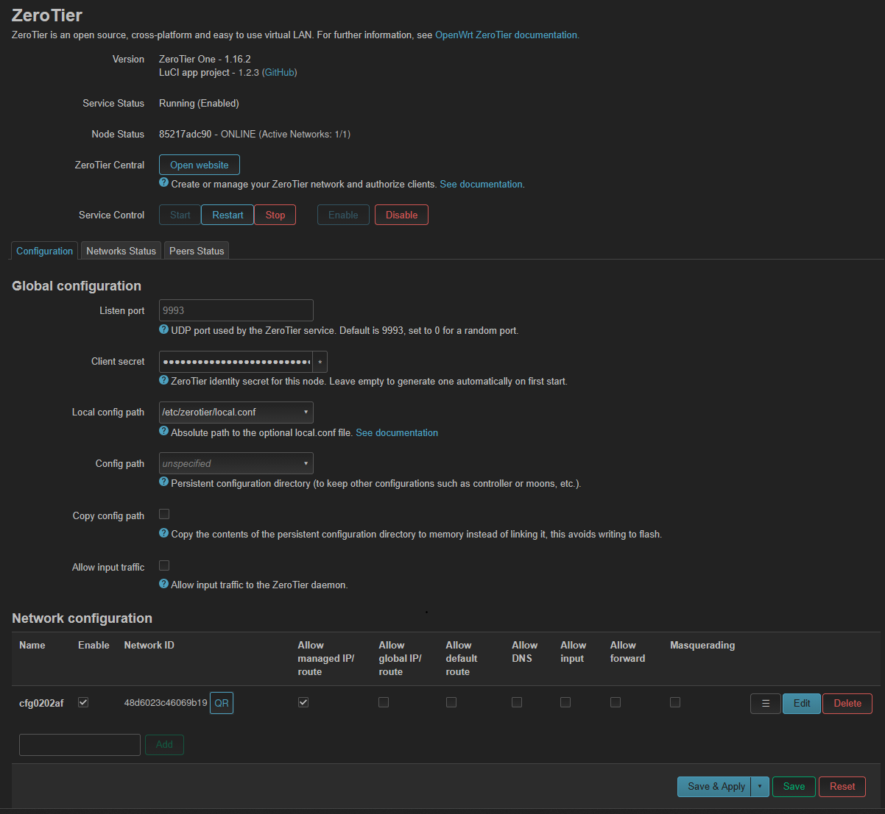
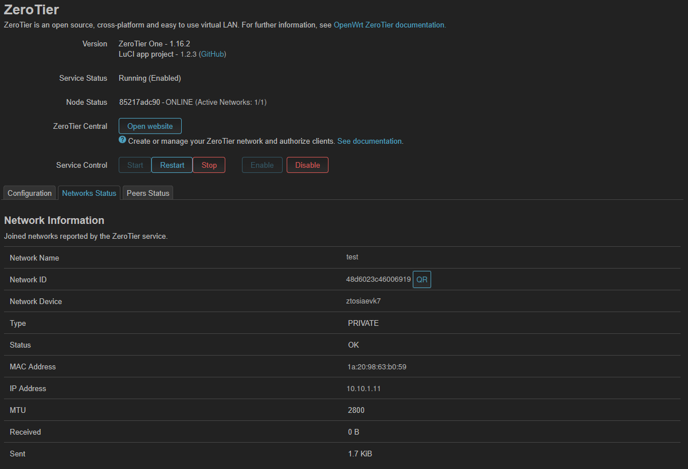
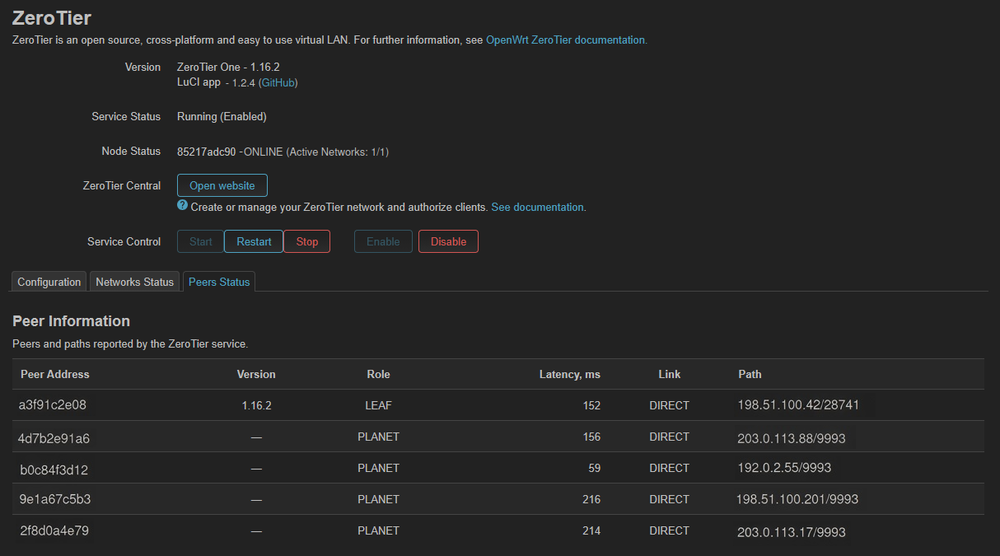

# luci-app-zerotier

LuCI application for configuring and managing ZeroTier on OpenWrt and ImmortalWrt.  
Based on the package developed for the ImmortalWrt LuCI project.

## Compatibility

- **OpenWrt** and **ImmortalWrt** (same package; ImmortalWrt-only options appear only when supported)
- **OpenWrt** 19.07 and newer (including 21.02, 23.05, 24.10, 25.12)

## New Features

- Dedicated rpcd backend (luci.zerotier).
- **Service control** (start / stop / restart / enable / disable), with status:
  - Running / Stopped, Enabled / Disabled (autostart)
  - ZeroTier One version and LuCI app version (with project link)
  - Node information, networks summary (active / total)
- Single overview page: status panel plus **Configuration**, **Networks Status**, and **Peers Status** tabs:
  - **Networks Status** - joined networks from the ZeroTier service: network name, network ID, device, type, status, MAC address, IP address(es), MTU, received / sent traffic
  - **Peers Status** - peers from the ZeroTier service: peer address, version, role, latency, link (DIRECT / RELAY), preferred path
- Status widget on LuCI **Status -> Overview** (service, node, networks summary).
- Feature detection for OpenWrt vs ImmortalWrt (extra firewall / network options only when supported).

## Interface





## Installation

> **Note:** ZeroTier package **1.16.2** or later is recommended.

1. Download 'luci-app-zerotier' from the [Releases](https://github.com/Ser9ei/luci-app-zerotier/releases) page. Prefer the build for your OpenWrt (apk/ipk). The package is architecture-independent.

2. Copy the file to the router and install it:

   ```sh
   # OpenWrt 25.12 and newer (apk / .apk)
   apk add --allow-untrusted --force-reinstall luci-app-zerotier-*.apk
   ```

   ```sh
   # OpenWrt 24.10 and older (opkg / .ipk)
   opkg install --force-reinstall luci-app-zerotier_*.ipk
   ```
3. Refresh LuCI (or clear the browser cache), then open **Services → ZeroTier**.

## Credits & License

Thanks to the [ImmortalWrt LuCI](https://github.com/immortalwrt/luci) contributors who developed and maintained the original luci-app-zerotier package.

Service control UI patterns were inspired by luci-app-pbr by [@stangri](https://github.com/stangri).

Licensed under the GNU General Public License v3.0 only (GPL-3.0-only).  
Copyright notices and SPDX license identifiers are preserved from the original source files.
